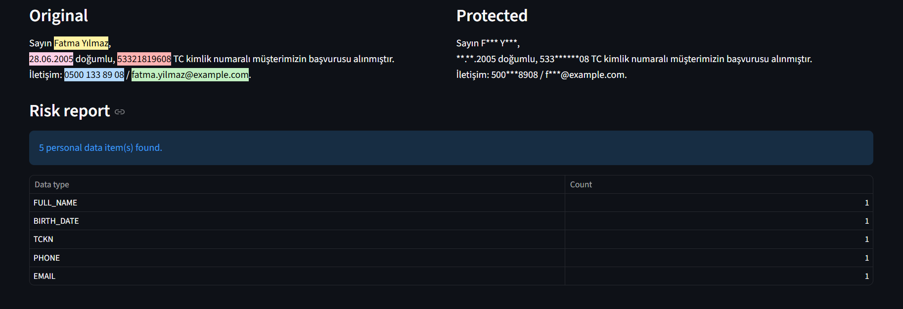
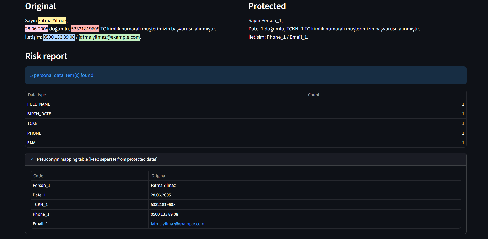

# KVKK Personal Data Masking Tool

A Python + Streamlit tool that detects personal data in free text or CSV/Excel files and protects it
(masking, pseudonymization or removal) before the data is sent to a test environment or an AI tool.
Built as a course project for an IT Law class, focusing on the Turkish Personal Data Protection Law (KVKK, Law No. 6698).

> All sample data in this repository is synthetic. Numbers are generated to pass validation algorithms
> but are not linked to any real person. Do not enter real personal data into the tool.

## Features

- **Detection of 7 data types:** Turkish ID number (TCKN), mobile phone, email, IBAN, credit card, birth date, full name
- **Validation to reduce false positives:** TCKN check digits, IBAN mod-97, Luhn for cards, real calendar dates
- **Three protection methods** (see below), selectable in the UI
- **Text tab:** original text with color-highlighted findings next to the protected text
- **File tab:** CSV / Excel upload, protected table preview and download in the same format
- **Risk report:** count per data type and warnings for special category data keywords (KVKK Art. 6)
- **Synthetic data generator** for safe testing

## Protection methods

| Data type | Masking | Pseudonymization | Removal |
|---|---|---|---|
| Phone | `532***4567` | `Phone_1` | `[REMOVED]` |
| TCKN | `123******50` | `TCKN_1` | `[REMOVED]` |
| Email | `a***@ornek.com` | `Email_1` | `[REMOVED]` |
| IBAN | `TR40 **** **** **** **** **67 89` | `IBAN_1` | `[REMOVED]` |
| Credit card | `**** **** **** 1111` | `Card_1` | `[REMOVED]` |
| Birth date | `**.**.1990` | `Date_1` | `[REMOVED]` |
| Full name | `A*** Y***` | `Person_1` | `[REMOVED]` |

In pseudonymization the same value always gets the same code, even when written differently
(`0532 123 45 67` and `+905321234567` are both `Phone_1`). In the file tab one mapping is shared by
the whole table, so the same person gets the same code in every row. The mapping table is shown
separately, because whoever holds it can reverse the pseudonyms.

## Example

Input:

```
Sayın Fatma Yılmaz,
28.06.2005 doğumlu, 53321819608 TC kimlik numaralı müşterimizin başvurusu alınmıştır.
İletişim: 0500 133 89 08 / fatma.yilmaz@example.com.
```

Output with pseudonymization:

```
Sayın Person_1,
Date_1 doğumlu, TCKN_1 TC kimlik numaralı müşterimizin başvurusu alınmıştır.
İletişim: Phone_1 / Email_1.
```

## Screenshots

Masking, with highlighted findings and the risk report:



Pseudonymization, with the mapping table shown separately:



## How detection works

1. A regular expression finds candidates for each data type.
2. Candidates are checked with the matching validation algorithm (for example, a random 11-digit number
   that fails the TCKN check digits is ignored).
3. Dates count as birth dates only if a word like "doğum" or "birth" is nearby (or the CSV column name says so).
4. Full names are found with a dictionary of common Turkish first names followed by capitalized words,
   and after hints such as "Sayın" or "Ad Soyad:".
5. Overlapping findings are resolved by priority (IBAN > card > TCKN > phone > birth date > email > name),
   so the digits inside an IBAN are not reported again as a card number.

## Project structure

```
app.py                      Streamlit UI (Text and File tabs), contains no detection logic
kvkk/
  validation.py             TCKN, IBAN, Luhn and date validation
  detection.py              Patterns, find_all(), overlap resolution, name detection
  protection.py             Masking, PseudonymTable, protect_text()
  risk.py                   Counts per type, special category keyword search
  highlight.py              Findings as colored HTML (input is escaped)
  file_io.py                CSV/Excel reading, table protection, download bytes
  dictionaries/             First names and special category keywords
scripts/generate_fake_data.py   Synthetic people, sample text, CSV and Excel
sample_data/                Generated sample files
tests/                      pytest tests for every module
```

## Setup

```bash
python -m venv .venv
.venv\Scripts\activate        # Windows
pip install -r requirements.txt
```

## Usage

```bash
streamlit run app.py
```

- **Text tab:** paste text (for example from `sample_data/sample_text.txt`), choose a method, click *Protect*.
- **File tab:** upload `sample_data/sample_people.csv` or `.xlsx`, then download the protected file.

To regenerate the sample files:

```bash
python -m scripts.generate_fake_data
```

## Tests

```bash
pytest -v
```

## Limitations

This tool is an aid for human review, not a guarantee of KVKK compliance.

- **Missed data (false negatives):** full names written in all capitals (`AHMET YILMAZ`), first names on
  their own, names missing from the dictionary without a hint word, landline numbers, addresses,
  licence plates and other identifiers are not detected.
- **Indirect identifiers:** age, city, job title and similar details can identify a person when combined,
  even after masking. The tool does not measure this.
- **Special category data** is only flagged by keywords, without understanding context; the warning
  may be a false alarm, and the data is not removed automatically.
- **Pseudonymized data is still personal data** as long as the mapping table exists.
- For Excel files only the first sheet is processed.

## Legal background (short)

- **Personal data (KVKK Art. 3):** any information relating to an identified or identifiable natural person.
- **Anonymization vs. pseudonymization:** anonymized data can no longer be linked to a person even when
  combined with other data; pseudonymized data can, through the mapping table. Masking is often not full
  anonymization either.
- **Special categories (KVKK Art. 6):** health, religion, union membership, criminal records, biometric and
  genetic data and others need stricter processing conditions, so the tool warns instead of deciding.
- **Data minimization (KVKK Art. 4) and data security (KVKK Art. 12):** removing personal data before
  sharing text with test systems or AI services is a technical measure in this direction.
